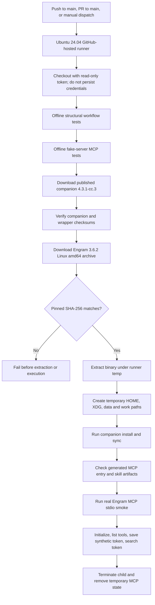

# Linux published-companion CI smoke

This guide explains what the Linux CI workflow proves, how its isolated MCP check works, and where its trust boundary ends. It is for maintainers reviewing or updating the published-companion smoke test; it is not a general Linux support guarantee.

## Quick summary

- **Runs on:** every push to `main`, every pull request targeting `main`, and manual dispatch.
- **Runner:** disposable GitHub-hosted `ubuntu-24.04` (Linux amd64).
- **Checks:** offline workflow/MCP harness tests, then the published companion install/sync, a real Engram MCP save/search round-trip, and installed `skill-creator` artifact checks.
- **Models and credentials:** no LLM is invoked; no model/provider credentials or repository secrets are deliberately passed to the test.
- **Network:** unrestricted. The runner downloads public release assets and installer dependencies; this workflow is not a network sandbox.

## Execution flow



The workflow is defined in [`../.github/workflows/linux-companion-e2e.yml`](../.github/workflows/linux-companion-e2e.yml). It runs the offline tests before [`../tests/companion-e2e.ps1`](../tests/companion-e2e.ps1), which provisions the published release and invokes [`../tests/engram-mcp-smoke.py`](../tests/engram-mcp-smoke.py).

## Workflow and permissions

| Setting | Current behavior | Why it matters |
|---|---|---|
| Events | `push` to `main`, `pull_request` targeting `main`, `workflow_dispatch` | No path filters: a change outside a hand-maintained file list must not silently skip this coverage. |
| Runner | `ubuntu-24.04` only; 25-minute job timeout | Keeps this change Linux-first and bounds the job. |
| Repository permission | `contents: read` | Avoids write access to repository contents. |
| Checkout | SHA-pinned `actions/checkout` with `persist-credentials: false` | The checkout token is not left in Git configuration for later test commands. |
| PR mode | Ordinary `pull_request`; no `pull_request_target` | PR code runs without the privileged target-branch workflow context. |
| Secrets | No repository secrets are referenced or passed by the workflow | The test does not need model/provider credentials. |

The Windows workflow is unchanged. This workflow does not add Windows or macOS coverage.

## Runner isolation and trust boundary

The PowerShell harness refuses to run unless `GITHUB_ACTIONS=true`, `RUNNER_ENVIRONMENT=github-hosted`, and `RUNNER_TEMP` are present. It places the companion destination, work directory, HOME, XDG configuration/cache/data paths, and temporary directories below a unique directory in `RUNNER_TEMP`. The MCP helper independently creates a temporary directory under `/tmp` for its HOME, data store, XDG paths, scratch project, and work directory.

The helper starts the verified Engram executable directly with an argument vector; it does not evaluate the generated MCP command through a shell. Its child environment is an explicit allowlist and omits GitHub, cloud, and model-provider credentials. Prompt capture is explicitly disabled for the synthetic save.

**This is isolation on a disposable hosted VM, not an OS sandbox.** Network access is unrestricted, and the `full-gentleman` preset can install the auxiliary GGA tool into `/usr/local/bin` and use a checkout below `/tmp`. Those effects are on the ephemeral GitHub-hosted runner. Do not remove the hosted-runner guard or run this integration script on a developer machine or self-hosted runner without redesigning its side effects and trust boundary.

## Published binaries and checksum gates

The companion installer downloads the public `4.3.1-cc.3` release and verifies its companion/wrapper pair against the release checksum manifest before installing. The Linux E2E then downloads Engram `v3.6.2` (`engram_3.6.2_linux_amd64.tar.gz`) and compares the archive SHA-256 to this pinned value before extracting or executing it:

```text
3527b7e7e8692fd4aaaf576d331cded19155523cf8b02c2de38744cccb229e89
```

After extraction, the test requires exactly one regular `engram` executable, makes it executable, prepends its directory to `PATH`, and verifies that the companion-generated MCP entry resolves to this same binary with arguments `mcp --tools=agent`. A checksum mismatch or unexpected/link-resolved binary fails the step before the MCP smoke.

These checks establish artifact integrity relative to the configured checksum source; they do not make the release publisher or unrestricted network trustworthy by themselves. Treat changes to release versions, URLs, checksum sources, and extraction logic as supply-chain-sensitive.

## Real MCP smoke: what is exercised

The helper uses only Python's standard library. It starts the Engram binary with `mcp --tools=agent`, a temporary working directory, and a minimal environment. The temporary `.engram/config.json` gives the synthetic project a local identity; it contains no user or repository data.

The stdio client performs this protocol sequence:

1. Send `initialize` with MCP protocol version `2024-11-05`.
2. Send `notifications/initialized` and call `tools/list`.
3. Require the `mem_save` and `mem_search` tools.
4. Save a generated synthetic token under a unique project with `capture_prompt: false`.
5. Search for that token in the same project and require it in the response.

Each request has a finite timeout; responses are capped at 1 MiB. The helper rejects malformed or mismatched JSON-RPC responses and tool errors. A `finally` path terminates the server process group, closes pipes, and removes the temporary state. Engram's `mem_search` uses local FTS5 search; the test calls MCP tools directly and does not ask a model to select tools, produce text, or interpret results.

The fake-server suite tests the client contract and failure cleanup without network access or a real Engram binary. It does **not** replace the hosted real-server round-trip.

## Installed skill checks

On Linux, after both `install` and `sync`, the harness checks these files under the temporary CommandCode home:

- `skills/skill-creator/SKILL.md`
- `skills/skill-creator/references/skill-style-guide.md`

It requires the expected paths to exist, rejects reparse-point links, checks that both files are nonempty regular files, checks the `skill-creator` front-matter name, and requires a Markdown heading in the style guide. These are deterministic artifact checks only: they prove that the release installed recognizable files, **not** that a model follows the skill correctly.

## Local checks and hosted evidence

Offline checks can be run from the repository root:

```bash
python3 tests/test_linux_release_workflow.py
python3 tests/test_engram_mcp_smoke.py
```

The integration PowerShell script is intentionally guarded and requires a disposable GitHub-hosted runner. Local structural tests and YAML parsing do not prove release downloads, PowerShell execution, or real Engram interoperability. `pwsh` and `actionlint` were not available in the local environment used to prepare this workflow; the hosted job ran the PowerShell step.

For the initial rollout, [PR run 42186838305](https://github.com/AngelCLA/gentle-ai-cc/actions/runs/42186838305) and [main run 42186895135](https://github.com/AngelCLA/gentle-ai-cc/actions/runs/42186895135) completed successfully. The downloaded logs showed checksum success for the companion assets, Engram `3.6.2`, passing install/sync assertions, 20 verification checks with no failures, and `Engram MCP smoke passed`. The PR event log uses GitHub's synthetic merge checkout; the main run used merge commit `33c1a1e`. A public comparison reported the PR-head and main-merge trees identical.

## Scope and limitations

- This is published-release evidence for the tested Ubuntu amd64 runner, not every Linux distribution or CPU architecture.
- Windows coverage remains in its existing workflow; macOS coverage is not added here.
- Network access is unrestricted; this is not a supply-chain sandbox.
- No model is run. The skill check cannot measure model adherence.
- A passing fake MCP test is not evidence that the published Engram binary works; the hosted real MCP step supplies that evidence.
- Hosted runs exercise external release artifacts and the full preset on an ephemeral machine. Keep the runner guard, temporary paths, least-privilege permissions, and checksum gates intact when maintaining the workflow.

## Maintenance checklist

When updating this smoke:

- [ ] Keep the workflow on all `main` pushes and `main` PRs; do not add path filters that can skip required coverage.
- [ ] Keep only the Ubuntu runner for this Linux-focused change unless scope is explicitly expanded.
- [ ] Update Engram's URL, version, and reviewed SHA-256 together; never accept an unverified archive.
- [ ] Preserve direct argument-vector launch, the child-environment allowlist, timeouts, size bounds, and process-group cleanup.
- [ ] Keep synthetic project/token data, `capture_prompt: false`, and temporary storage.
- [ ] Update the skill path/markers only when the installed artifact contract changes; continue to state that these are not model-adherence tests.
- [ ] Review network and filesystem side effects of the full preset before changing the hosted-runner guard.
